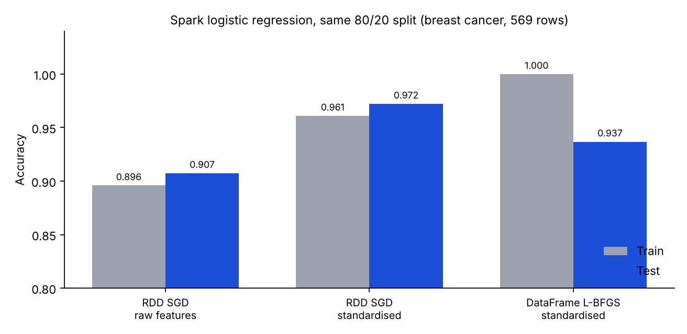

# Spark Logistic Regression: RDD API vs DataFrame API

Binary classification of the Wisconsin breast-cancer data (569 rows, 30 features) with Apache Spark, using the old RDD-based `pyspark.mllib` `LogisticRegressionWithSGD` and the DataFrame-based `pyspark.ml` pipeline (`VectorAssembler`, `StandardScaler`, `LogisticRegression` with L-BFGS).



## Results

Re-run for this repo with PySpark 4.3.0 (local mode, seed 42), data from scikit-learn's bundled copy:

| Setup | Train | Test |
|---|---|---|
| **As assigned:** RDD SGD, raw features, 75/25 split | 0.9041 | 0.9084 |
| **As assigned:** DataFrame L-BFGS, standardised, 80/20 split | 1.0000 | 0.9368 |
| **Controlled (80/20):** RDD SGD, raw features | 0.8959 | 0.9074 |
| **Controlled (80/20):** RDD SGD, standardised features | 0.9610 | **0.9722** |
| **Controlled (80/20):** DataFrame L-BFGS, standardised | 1.0000 | 0.9368 |

## What the comparison actually shows

The original write-up concluded that the DataFrame API "clearly performs better" (test 0.9368 vs 0.8851 in the notebook's run). The controlled rows say something different:

- The two assigned runs differ in **three** things at once: API, optimiser, and whether the features were standardised (plus the split ratio). Most of the gap is feature scaling: standardising the inputs lifts the RDD SGD model from 0.907 to **0.972**, which is *above* the DataFrame model's 0.937.
- The DataFrame model scores **1.0000 on train** but 0.9368 on test. A perfect training score with a lower test score is the pattern of overfitting (the notebook's printed intercept of about -288 also points to very large weights, and no regularisation was set), and its test score is not better than the simpler SGD model's.
- Each test set has roughly 100 to 115 rows, so one row is about one percentage point. The 0.937 vs 0.972 difference is a handful of patients, so neither ordering is established from one split.
- The genuine API differences are practical: the DataFrame API gives a reusable `Pipeline`, handles feature scaling for you, and is the maintained interface; the RDD `mllib` class is deprecated ("Deprecated in 2.0.0", as Spark itself warns when you call it).

## Reproducibility notes

- The assignment loaded `breast_cancer.csv` for the RDD run and scikit-learn's copy for the DataFrame run. This repo uses scikit-learn's copy for both so it runs anywhere; the DataFrame row reproduces the notebook's 1.0 / 0.9368 exactly, while the RDD row (0.9041 / 0.9084 here, 0.8979 / 0.8851 in the notebook) differs; likely causes are the different data file and Spark version, which I did not isolate.
- `results/logreg_results.json` holds every number above.

## Run it

```bash
pip install pyspark pyarrow scikit-learn matplotlib   # needs Java 17+
python src/spark_logreg.py --controlled
python make_chart.py
```

## Notebook

[`notebooks/HW3_Part2_Spark_LogReg.ipynb`](notebooks/HW3_Part2_Spark_LogReg.ipynb) is the original assignment notebook with saved outputs (student identifiers and Colab account metadata removed).

## Files

| File | Purpose |
|---|---|
| `src/spark_logreg.py` | Both Spark approaches, as-assigned and controlled runs |
| `results/logreg_results.json` | Output of the script |
| `make_chart.py` | Builds the chart |

## Stack

`Python` `Apache Spark (PySpark MLlib)` `scikit-learn` `matplotlib`
